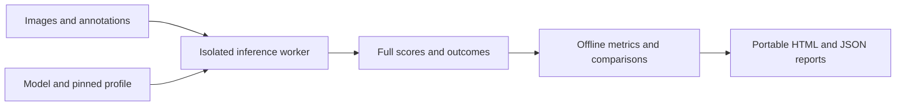

# Vision Bench

[](https://github.com/TimeOfAnarchy/vision-bench/actions/workflows/ci.yml)
[](LICENSE)

A lightweight local benchmark for comparing image tagging models and checkpoints.
Run inference once, keep every prediction, and compare saved runs offline.

[Autotagging case study](https://timeofanarchy-vision-bench.hf.space/#autotagging) ·
[Latest release](https://github.com/TimeOfAnarchy/vision-bench/releases/latest) ·
[Tagging guide](docs/taggers.md) · [VLM experiments](docs/vlm.md)

## Why I built it

New image models keep appearing, and I also fine-tune my own checkpoints. I needed
a small evaluation tool I could keep using as the models changed: the same frozen
images, explicit preprocessing and thresholds, and saved predictions I could
inspect again without another inference run.

Image autotagging is the main worked example. The benchmark keeps application
rules outside its evaluation pipeline and accepts custom profiles for local
artifacts. It also supports versioned image-chat tasks against an existing VLM
server.

## What it does

- **Compare complete predictions.** Preserve the full model vocabulary and scores;
  recompute metrics and compare runs without loading images or models again.
- **Make comparisons explicit.** Verify input hashes, pair successful samples and
  separate common-vocabulary quality from each model's native vocabulary coverage.
- **Measure practical pipelines.** Record decode/preprocessing/inference latency,
  model loading and optional Windows GPU process-memory samples.
- **Keep failures visible.** Failed samples have a separate mask and diagnostic
  records. Existing run IDs and output files are never silently reused.



The core package uses NumPy, Pillow and jsonschema. Install the inference runtime
you need separately; the tool does not manage a database or start model services.

## Autotagging in practice

The [case study on Hugging Face](https://timeofanarchy-vision-bench.hf.space/#autotagging)
compares PixAI 1.0 and CAFormer preprocessing/resolution variants on the same
1,024-image selection. It examines ranking quality, fixed-threshold decisions,
vocabulary coverage, measured latency and process memory.

The report includes the question, measured trade-offs, model revisions and
measurement limits. Source annotations are incomplete silver labels; the exact
image selection is private, so the published aggregates do not enable an exact
rerun of that experiment. You can reproduce the complete tool workflow with the
generated example below.

## Try the workflow without model downloads

Python 3.11+ is required. Clone the repository and create an environment:

```console
git clone https://github.com/TimeOfAnarchy/vision-bench.git
cd vision-bench
python -m venv .venv
```

Activate it with `.venv\Scripts\Activate.ps1` on Windows PowerShell or
`source .venv/bin/activate` on Linux/macOS, then run:

```console
python -m pip install ".[cpu,demo]"
python examples/create_demo.py --output .local/demo-inputs
vision-bench validate --dataset .local/demo-inputs/dataset.json
vision-bench run --dataset .local/demo-inputs/dataset.json --profile .local/demo-inputs/profile.json --model-root .local/demo-inputs/model --output .local/demo-runs --run-id colors --warmup 1
vision-bench recompute .local/demo-runs/colors
```

Open `.local/demo-runs/colors/report.html`. Recomputation prints
`{"matches": true}`. Choose new input directories and run IDs for repeat attempts.

The example generates four synthetic images and a tiny untrained ONNX graph. It
checks the complete workflow; its toy scores do not measure real tagger quality.
See the [example details](examples/README.md).

## Use your own models

Supply local images, an annotation manifest and a hash-pinned model profile.
Bundled ONNX profiles cover CAFormer B36 FP32/AMP FP16, PixAI v0.9/v1.0 Mexes FP16,
WD EVA02 v3, CL v2 and Camie v2. Optional PyTorch CAFormer profiles support
controlled resolution experiments. Model weights and datasets are supplied
separately under their own terms.

Choose **one** ONNX runtime extra per environment: `cpu`, `dml` (Windows) or
`cuda`. These distributions share a Python import, so use separate environments
for different runtimes. The optional `torch` extra is separate.

```console
vision-bench validate --dataset ./dataset.json
vision-bench run --dataset ./dataset.json --profile builtin:caformer-b36 --model-root ./caformer-pack --output ./runs
vision-bench recompute ./runs/my-run
vision-bench compare ./runs/model-a ./runs/model-b --output ./comparison.json
```

Use the actual generated run directories for offline commands. See:

- [Tagging guide](docs/taggers.md): manifests, model packs, providers, metrics,
  precision comparisons, GPU memory and PyTorch experiments.
- [Reproducibility and measurement boundaries](docs/reproducibility.md): input
  provenance, incomplete labels and interpretation limits.
- [Publishing reports](docs/publishing-results.md): portable aggregate HTML,
  Markdown, JSON and checksums.
- [VLM experiments](docs/vlm.md): versioned tasks, strict response validation,
  repeat stability, offline comparison and human review exports.
- [Library integrations and conversion tools](docs/integrations.md): CPU session
  limits, image admission limits, ONNX conversion and HTTP diagnostics.

## Development and verification

```console
python -m pip install -e ".[dev,cpu]"
python -m pytest
python -m ruff check .
python -m ruff format --check .
python -m build
```

The [CPU workflow](https://github.com/TimeOfAnarchy/vision-bench/actions/workflows/ci.yml)
builds wheel and source archives, installs the wheel in a fresh environment
outside the checkout, and runs the shipped tests and generated example on Linux
and Windows. Tests use small generated models and temporary images. Real models,
GPU providers and VLM servers require separate experiment evidence.

To check an installed package locally, choose new output directories:

```console
python -m build --outdir .local/package-dist
python scripts/check_distribution.py --dist .local/package-dist --work .local/package-check
```

## License

Code, documentation and generated example inputs are licensed under [MIT](LICENSE).
Model weights and third-party datasets keep their own terms; they are not included
or relicensed by this project.
